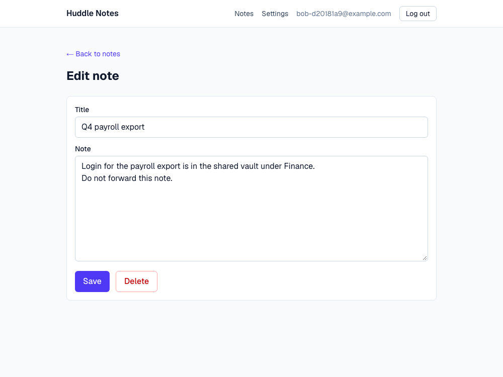
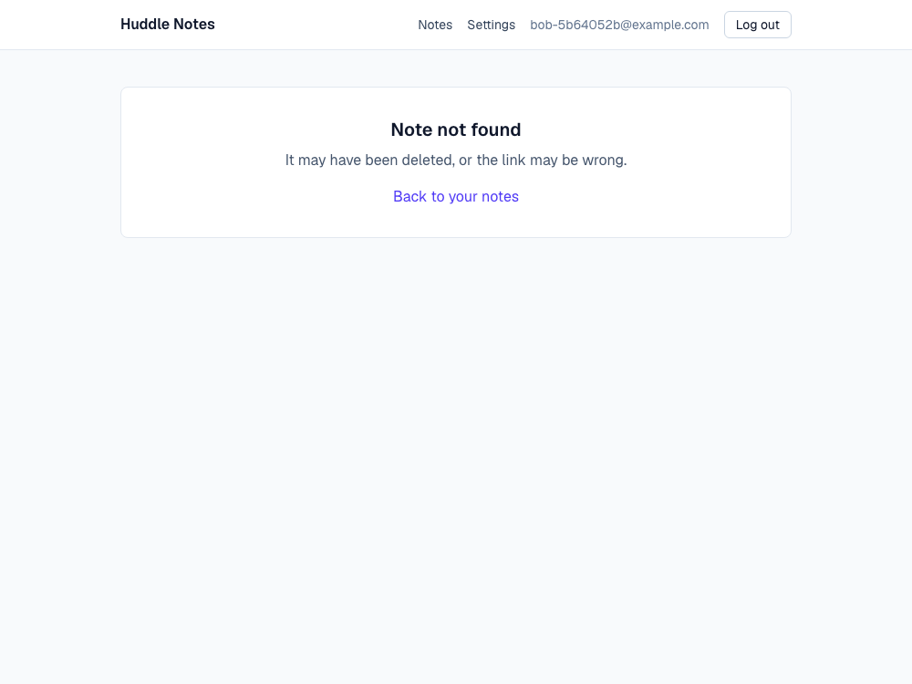

# Rescuing an AI-built app: Supabase auth and Row Level Security fixes

**Personal demo project.** Not client work. "Huddle Notes" is a made-up notes app, and all
data in it is sample data.



_Before: signed in as Bob, changing the number in the URL opens Alice's note, with working
Save and Delete buttons._

## What this demonstrates

- Auditing a Next.js + Supabase app and writing up each issue with a reproduction, a severity
  and a plain-English impact: [`docs/AUDIT.md`](docs/AUDIT.md)
- Fixing it properly: per-user Row Level Security in a SQL migration, the service-role key
  kept on the server, cookie sessions with middleware, a working email-confirmation flow, and
  loading, error and empty states
- Proving it: Playwright tests that fail on the original app and pass on the fix, running in
  CI against a real local Supabase stack (no mocks)
- Handing it over: a one-page [fix report](docs/fix-report.pdf) written for a non-technical
  owner

## How this repo is laid out

| Branch                  | What it is                                                                 |
| ----------------------- | -------------------------------------------------------------------------- |
| `main`                  | The app as generated, plus the audit and the tests that reproduce each issue |
| `fix/auth-and-rls`      | The fix, as one pull request against `main`                                |

**About the starting point.** The app on `main` was generated with an AI coding assistant
from a features-only brief (sign up, log in, write notes, delete your account) and committed
with no security review. It was built to stand in for the apps people bring to a rescue job,
so it has the shape those apps usually have: Supabase called straight from the browser, no
Row Level Security, and a service key in client code. The audit lists only issues that were
reproduced in this code, and the fix was written with AI assistance and reviewed line by line.

## Results

Same 15 tests, same local Supabase stack, both branches.

| Test                                                              | `main` | fix  |
| ----------------------------------------------------------------- | ------ | ---- |
| Bob cannot open Alice's note by its URL                           | FAIL   | pass |
| A signed-out visitor cannot open Alice's note by its URL          | FAIL   | pass |
| Bob's token cannot read Alice's note                              | FAIL   | pass |
| Bob's token cannot edit Alice's note                              | FAIL   | pass |
| Bob's token cannot delete Alice's note                            | FAIL   | pass |
| Bob cannot create a note in Alice's account                       | FAIL   | pass |
| The public anon key alone cannot read or write notes              | FAIL   | pass |
| The service-role key is not in any file the browser can download  | FAIL   | pass |
| A new user can sign up, confirm by email, and land in the app     | FAIL   | pass |
| A wrong password shows an error                                   | FAIL   | pass |
| A user with no notes is told so                                   | FAIL   | pass |
| A user can log in and log out                                     | pass   | pass |
| Alice still sees her own note                                     | pass   | pass |
| A user can still add, edit and delete their own notes             | pass   | pass |
| Deleting an account removes the user and their notes              | pass   | pass |
| **Total**                                                         | **4 / 15** | **15 / 15** |

The "straight to the API" tests matter most. They skip the app and talk to Supabase with
Bob's own login token, which is what an attacker would do, so they pass only if the database
itself refuses.



_After: the same URL. The database returns nothing, so the page cannot even confirm the note
exists._

## The fix in brief

| Finding (see the audit)                          | Fix                                                                                                   |
| ------------------------------------------------ | ----------------------------------------------------------------------------------------------------- |
| 1. Anyone can read or change anyone's notes      | RLS enabled; one owner-only policy each for select, insert, update, delete; `anon` loses all access   |
| 2. Service-role key in the browser               | Key is server-only and used in one module, for one job; `server-only` fails the build if that changes |
| 3. Notes open by URL, even signed out            | Server-rendered pages behind middleware; other people's notes are "not found"                         |
| 4. Browser decides who owns a note               | `user_id` defaults to `auth.uid()`, `NOT NULL`, foreign key with cascade; the app stops sending it    |
| 5. Sign-up strands new users                     | "Check your email" message; `/auth/confirm` verifies the link on the server and signs the user in     |
| 6. Silent failures                               | Form errors and pending states; loading, empty, error and not-found states                            |

The migration is the part to read first:
[`supabase/migrations/20261011000000_secure_notes.sql`](https://github.com/coltonpomeroy/supabase-rls-rescue/blob/fix/auth-and-rls/supabase/migrations/20261011000000_secure_notes.sql).

## Run it yourself

Needs Node 22, pnpm, Docker, and the [Supabase CLI](https://supabase.com/docs/guides/cli).

```bash
pnpm install
supabase start          # local Postgres, Auth, REST and a mail catcher; applies migrations
pnpm env:local          # writes .env.local from the local stack
pnpm build
pnpm exec playwright install chromium
pnpm test:e2e           # 11 failures on main, 0 on fix/auth-and-rls
```

When switching branches, run `supabase stop && supabase start && supabase db reset`, then
`pnpm env:local && pnpm build`, so the database, auth settings and build all match the branch.

To click around: `pnpm dev` and open the URL it prints. Confirmation emails land in the local
mail catcher at <http://127.0.0.1:54324>.

## Deploying the fix to a hosted Supabase project

Code alone does not finish the job. In the Supabase dashboard:

1. **Rotate the service-role key** if the old one was ever in a public build, then set the
   new one as `SUPABASE_SERVICE_ROLE_KEY` on the server only.
2. **Authentication > URL Configuration:** set Site URL to the real domain.
3. **Authentication > Email Templates > Confirm signup:** paste
   [`supabase/templates/confirmation.html`](https://github.com/coltonpomeroy/supabase-rls-rescue/blob/fix/auth-and-rls/supabase/templates/confirmation.html).
4. Run the migration (`supabase db push`), then check the `notes_orphaned` table for rows
   that had no valid owner.

## Stack

Next.js 15 (App Router), TypeScript, Supabase (Auth, Postgres, Row Level Security), Tailwind
CSS, Playwright, GitHub Actions.
